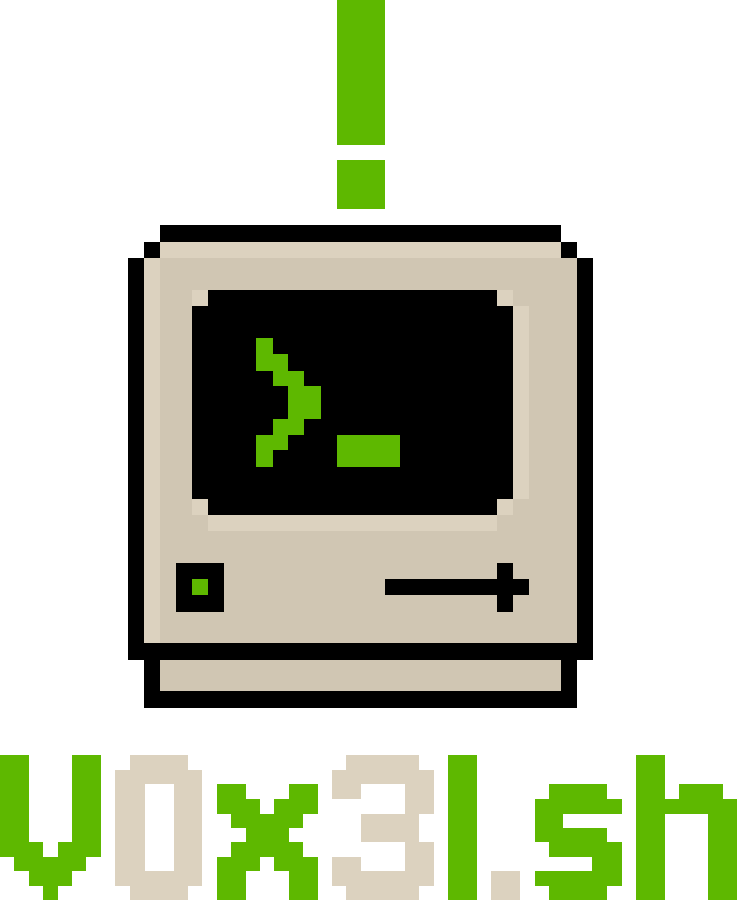

<p align="center">
  
</p>

<p align="center">
  <b>V0x3l</b> — Post-instalador modular para Ubuntu Server 26.04+ con interfaz TUI (urwid).
</p>

  <p align="center">
  <b>V0x3l</b> — Post-instalador modular para Ubuntu Server 26.04+ con interfaz TUI (urwid).
  </p>

<p align="center">
  
  
  
</p>

<p align="center"><i>Tu sistema. Tus reglas. Tu forja.</i></p>

---

## Instalación

```bash
curl -fsSL https://raw.githubusercontent.com/alexandrpunk/V0x3l/main/install.sh | bash
```

## Requisitos

- Ubuntu Server 26.04 LTS o superior
- Acceso root (sudo)
- Conexión a internet

## Características

- **Interfaz TUI**: urwid con split panel (pasos a la izquierda, output en vivo a la derecha)
- **6 secciones modulares**: Preparación, Rendimiento, Software, Configuración, Apariencia, Entorno
- **Checkpoint reanudable**: continúa desde donde quedó si falla
- **Monitor de paquetes**: barra de progreso, velocidad, contador durante instalaciones
- **Navegación**: teclas 1-7 para acciones directas, flechas para navegar
- **Aplicaciones por defecto**: Floorp, mousepad, viewnior, qpdfview y Cine (`mimeapps.list`)
- **Umbriel**: botones de ventana, Alt+Tab con el selector de Noctalia, cheatsheet bajo demanda
- **.env configurable**: nombre del proyecto, versión, rutas, repositorio desde archivo central
- **Comprobación de la instalación**: verifica que nada haya faltado (opción 6 del menú o `--check`)

## Uso

```bash
# Desde el repo clonado
sudo python3 -m v0x3l

# Demo de la interfaz (no modifica el sistema)
python3 demo_ui.py
```

### Comprobar la instalación

Utilidad de solo lectura: revisa paquetes, servicios, temas y dotfiles y dice
qué falta y cómo arreglarlo. No necesita root ni TTY.

```bash
# Informe por consola (exit 1 si hay fallos)
python3 -m v0x3l --check
```

Desde la TUI: opción **6 — Comprobar la instalacion** (<code>q</code>/<code>Esc</code> para cerrar).

### Wallpapers

El paso 5 copia `assets/wallpapers/` a `~/Pictures/v0x3l-wallpapers/` y deja
Noctalia configurado: fondo por defecto desde el primer arranque
(`[wallpaper.default]`) y rotación aleatoria cada 15 min
(`[wallpaper.automation]`; intervalo en `WALLPAPER_ROTATION_SECONDS` del `.env`).

La configuración vive en `~/.config/noctalia/90-v0x3l-wallpaper.toml`. Lo que
se elija desde la GUI se guarda en `~/.local/state/noctalia/settings.toml`, que
carga al final y tiene prioridad.

### Aplicaciones por defecto

El paso 3 escribe `~/.config/mimeapps.list`: Floorp (navegador; `http(s)` y
HTML), mousepad (texto plano), viewnior (imágenes), qpdfview (PDF) y Cine
(vídeo, el Flatpak que instala el paso 2).

### Escritorio (Umbriel)

El paso 3 completa `~/.config/umbriel/config.toml` partiendo del config
empaquetado: barra de título con minimizar/maximizar/cerrar (`mode = "forced"`),
Alt+Tab abre el selector de ventanas de Noctalia limitado al workspace actual, y
el cheatsheet de atajos ya no aparece en cada arranque (se abre con `Mod+F2`).
Thunar usa kitty como terminal (`~/.config/xfce4/helpers.rc`).

## Secciones

| # | Sección | Descripción |
|---|---------|-------------|
| 0 | Preparación del sistema | herramientas base, repos Noctalia, locale, zona horaria |
| 1 | Rendimiento y drivers | kernel XanMod Edge + GPU NVIDIA |
| 2 | Software | Wayland, Thunar, PipeWire, Flatpak, Noctalia, Umbriel, Kitty, codecs y fuentes MS core |
| 3 | Configuración | Polkit, UFW, red, servicios, TLP, Umbriel (botones/Alt+Tab), terminal de Thunar, apps por defecto, ly |
| 4 | Apariencia | Juno GTK, Pure icons, Plymouth, GRUB Vimix |
| 5 | Entorno | Oh My Zsh, LazyVim, harness OMP, dotfiles (kitty/tmux/fastfetch) |

## Recursos

Recursos utilizados:

| Proyecto | Enlace |
|----------|--------|
| Noctalia | https://docs.noctalia.dev/noctalia/ |
| Umbriel | https://docs.noctalia.dev/umbriel/ |
| ly | https://github.com/cmgeldenhuys/ly |
| GRUB Vimix | https://github.com/vinceliuice/vimix-grub2-theme |
| Juno GTK | https://github.com/EliverLara/Juno |
| Pure icon theme | https://github.com/mjkim0727/Pure-icon-theme |
| Kitty | https://sw.kovidgoyal.net/kitty/ |

## Versiones

- `optimizacion` — rama de instalación y desarrollo activo
- `main` — versiones estables

## Licencia

GPL-3.0

---

**> sudo make it yours**
