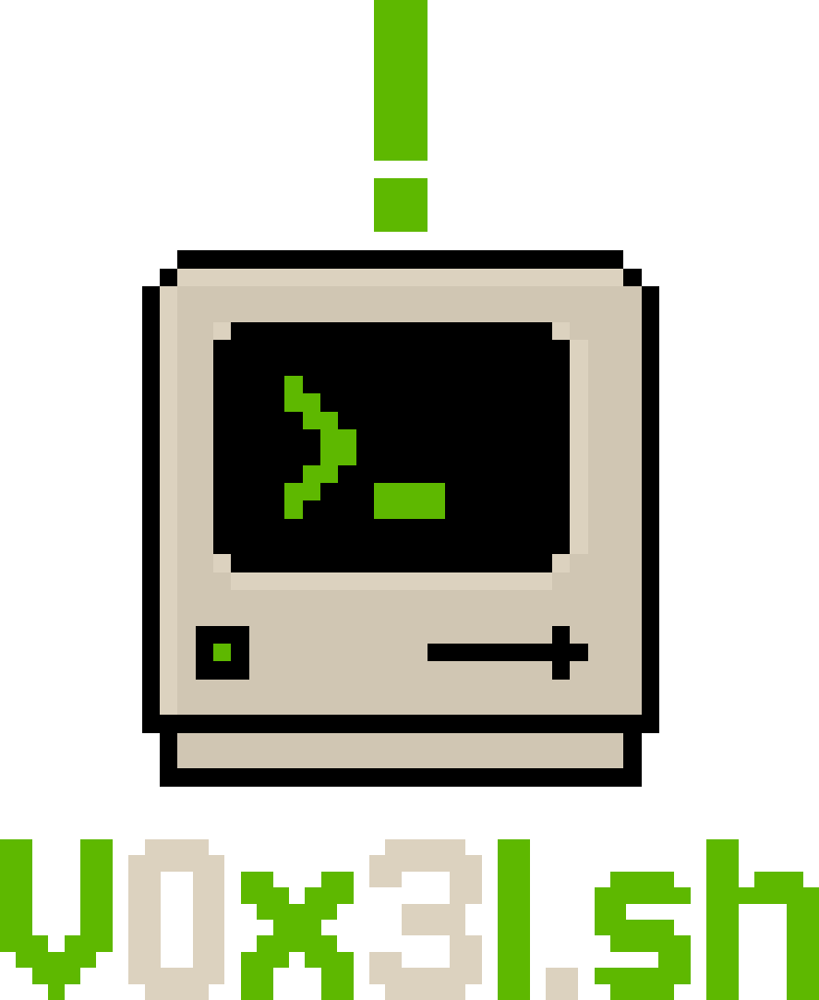

<p align="center">
  
</p>

<p align="center">
  <b>V0x3l</b> — Post-instalador modular para Ubuntu Server 26.04+ con interfaz TUI (urwid).
</p>

  <p align="center">
  <b>V0x3l</b> — Post-instalador modular para Ubuntu Server 26.04+ con interfaz TUI (urwid).
  </p>

<p align="center">
  
  
  
</p>

<p align="center"><i>Tu sistema. Tus reglas. Tu forja.</i></p>

---

## Instalación

```bash
curl -fsSL https://raw.githubusercontent.com/alexandrpunk/V0x3l/optimizacion/install.sh | bash
```

## Requisitos

- Ubuntu Server 26.04 LTS o superior
- Acceso root (sudo)
- Conexión a internet

## Características

- **Interfaz TUI**: urwid con split panel (pasos a la izquierda, output en vivo a la derecha)
- **6 secciones modulares**: Preparación, Rendimiento, Software, Configuración, Apariencia, Entorno
- **Checkpoint reanudable**: continúa desde donde quedó si falla
- **Monitor de paquetes**: barra de progreso, velocidad, contador durante instalaciones
- **Navegación**: teclas 1-6 para acciones directas, flechas para navegar
- **.env configurable**: nombre del proyecto, versión, rutas, repositorio desde archivo central

## Uso

```bash
# Desde el repo clonado
sudo python3 -m v0x3l

# Demo de la interfaz (no modifica el sistema)
python3 demo_ui.py
```

## Secciones

| # | Sección | Descripción |
|---|---------|-------------|
| 0 | Preparación del sistema | herramientas base, repos Noctalia, locale, zona horaria |
| 1 | Rendimiento y drivers | kernel XanMod Edge + GPU NVIDIA |
| 2 | Software | Wayland, Thunar, PipeWire, Flatpak, Noctalia, Umbriel, Kitty |
| 3 | Configuración | Polkit, UFW, red, servicios, TLP, Umbriel floating + sysc-greet |
| 4 | Apariencia | Colloid icons, Plymouth, GRUB Vimix |
| 5 | Entorno | Oh My Zsh, LazyVim y harness OMP |

## Recursos

Recursos utilizados:

| Proyecto | Enlace |
|----------|--------|
| Noctalia | https://docs.noctalia.dev/noctalia/ |
| Umbriel | https://docs.noctalia.dev/umbriel/ |
| sysc-greet | https://github.com/Nomadcxx/sysc-greet |
| GRUB Vimix | https://github.com/vinceliuice/vimix-grub2-theme |
| Kitty | https://sw.kovidgoyal.net/kitty/ |

## Versiones

- `optimizacion` — rama de instalación y desarrollo activo
- `main` — versiones estables

## Licencia

GPL-3.0

---

**> sudo make it yours**
